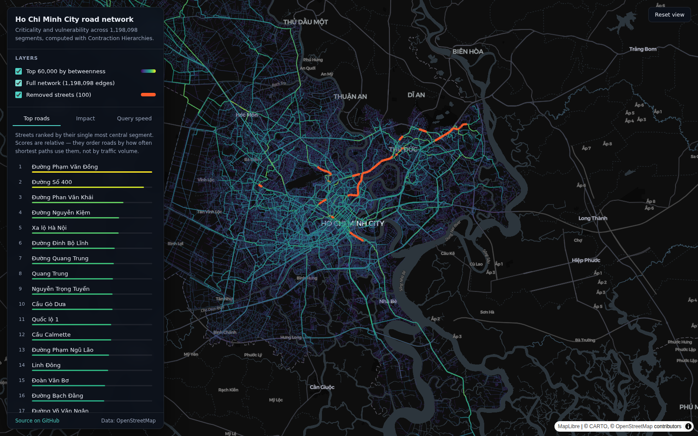

# Ho Chi Minh City Road Network — Criticality & Vulnerability

Which streets does Ho Chi Minh City actually depend on, and what does it cost when one of
them disappears?

This project models the city's road network as a directed graph of **550,935 intersections
and 1,198,098 road segments** built from OpenStreetMap, then answers both questions at a
scale where a plain Dijkstra is too slow to be useful:

- **Criticality** — approximate *edge betweenness centrality*, computed on top of a
  Contraction Hierarchy so that one source costs a fraction of a full shortest-path search.
- **Vulnerability** — delete the highest-scoring streets one at a time, rebuild the
  hierarchy, and re-route 1,000 benchmark trips to measure the extra distance travelled.
- **A map** — a static web viewer that renders every segment in the browser.



<sub>Every road segment in deep blue, the 60,000 most central in teal-to-yellow, and the
streets removed by the vulnerability simulation in orange.</sub>

---

## Results

### Query latency

Mean over 1,000 point-to-point queries, split by the degree band of the source node.
Contraction Hierarchies preprocesses the graph once, then answers queries **120× faster
than Dijkstra**.

| Algorithm | deg ≤ 4 | 5 ≤ deg ≤ 9 | deg ≥ 10 | Overall |
| --------- | ------: | ----------: | -------: | ------: |
| Dijkstra  | 5.928 s |     5.039 s |  4.003 s | 4.989 s |
| A\* (haversine) | 0.552 s | 0.421 s |  0.307 s | 0.427 s |
| **Contraction Hierarchies** | **0.047 s** | **0.041 s** | **0.036 s** | **0.041 s** |

### Most critical streets

Top segments by approximate betweenness, from 20,000 sampled sources.

| Street | Betweenness |
| ------ | ----------: |
| Phạm Văn Đồng | 8.9 × 10⁻⁵ |
| Đường Số 400 | 8.1 × 10⁻⁵ |
| Phan Văn Khải | 6.6 × 10⁻⁵ |
| Nguyễn Kiệm | 6.3 × 10⁻⁵ |
| Xa lộ Hà Nội | 6.2 × 10⁻⁵ |
| Đinh Bộ Lĩnh | 6.0 × 10⁻⁵ |
| Quang Trung | 5.9 × 10⁻⁵ |

### Cost of losing a street

Streets removed cumulatively, 1,000 benchmark trips re-routed after each removal.

| Removal # | Street removed | Segments | Δ cost | Cumulative Δ |
| --------: | -------------- | -------: | -----: | -----------: |
| 40 | Đường Võ Văn Ngân | 11 | 8,711 m | 18,414 m |
| 78 | Hẻm 26 Đường số 11 | 28 | 6,739 m | 29,754 m |
| 74 | Đường số 11 | 15 | 3,186 m | 23,000 m |
| 8 | Đường Nguyễn Kiệm | 2 | 2,144 m | 6,139 m |
| 4 | Đường Số 400 | 1 | 1,713 m | 2,586 m |

Removing all 100 streets adds 32,435 m to a baseline of 18,004,558 m — 0.18 % — so the
network as a whole is resilient, and the damage is concentrated in a handful of places.

Betweenness rank and removal cost come apart, which is the more interesting finding. Võ Văn
Ngân is only the 40th street removed by score, yet it is by far the most expensive to lose;
Đường Số 400 ranks 2nd by betweenness but costs a fifth as much. A high score raises the
odds that losing a street hurts, but redundancy in the surrounding grid decides the
magnitude.

---

## How it works

### Contraction Hierarchies

Preprocessing contracts nodes one at a time in order of increasing *edge difference*
(shortcuts added minus original edges removed). Removing a node `n` may break shortest
paths that ran through it, so a **shortcut** `u → v` is inserted whenever no witness path
around `n` is at least as short:

```
Imp(u) = shortcuts(u) − edges(u)
```

Witness searches are bounded by hop count, distance and number of settled nodes, and
priorities are recomputed lazily — only when a stale entry reaches the front of the queue.

Queries then run a **bidirectional Dijkstra** that only ever follows edges climbing the
hierarchy, meeting in the middle:

```
d(s, t) = min over k of  dist_up(s, k) + dist_down(t, k)
```

Shortcuts are unpacked recursively to recover the real road segments.

### Betweenness centrality

Betweenness counts how often an edge sits on a shortest path:

```
B(e) = Σ  σ_st(e) / σ_st
     s≠t
```

Computing this exactly means one shortest-path tree per node — 550,935 of them. Instead the
project samples sources and runs **Brandes' backward dependency accumulation** over the CH
upward search, unpacking shortcuts so credit lands on real segments:

```
δ_s(u) = Σ  (σ_su / σ_sv) · (1 + δ_s(v))
```

> [!IMPORTANT]
> **These are relative scores for ranking, not absolute centrality values.** The sweep only
> follows edges that climb the hierarchy, so it sees the first half of each shortest path —
> the part from the source up to the meeting node. The second half is credited when the
> other endpoint is sampled. Totals therefore come out well below exact betweenness, and the
> two directions of a street can differ sharply. Bottlenecks that every route must cross
> still rank at the top, which is what the criticality analysis needs.
> `tests/test_ch.py` pins both the property that holds and the limit that does not.
> For exact values on a smaller graph, use `networkx.edge_betweenness_centrality`.

### Edge removal

Adjacent segments of the same street score almost identically, so removing a single edge
says little. The simulator grows a **run** of connected segments whose scores match within
tolerance, removes the whole run, rebuilds the hierarchy and re-measures. Two modes:

- `cumulative` — removals stay in place, so damage compounds (the results above);
- `independent` — each street is restored before the next, isolating its individual cost.

---

## Repository layout

```
src/roadnet/          the analysis package
  ch.py               Contraction Hierarchies: preprocessing, unpacking, queries
  betweenness.py      Brandes accumulation over the hierarchy
  removal.py          edge-removal simulation
  benchmark.py        Dijkstra / A* / CH latency comparison
  sampling.py         degree-stratified query sampling
  data/               OSM extraction and graph preprocessing
  export/             numpy cache + binary payloads for the web viewer
web/                  the map viewer (React + deck.gl + MapLibre)
notebooks/            the original research notebooks, superseded by the package
tests/                correctness tests against networkx
```

## Getting started

```bash
python -m venv .venv && source .venv/bin/activate
pip install -e ".[dev]"          # add ".[osm,dev]" to rebuild the graph from OSM
pytest
```

### Rebuilding the analysis from scratch

Steps 1–2 need the `osm` extra plus the `osmconvert` binary
(`apt install osmctools`). Start from a country-level extract such as
[`vietnam-latest.osm.pbf`](https://download.geofabrik.de/asia/vietnam.html).

```bash
# 1. clip the country extract down to the city boundary
roadnet extract-region --source vietnam-latest.osm.pbf --output data/hochiminh.osm.pbf

# 2. build the directed, reindexed graph (~25 min, ~8 GB RAM)
roadnet build-graph --pbf data/hochiminh.osm.pbf --output data/graph.pkl

# 3. compare query algorithms
roadnet benchmark --graph data/graph.pkl --algorithm ch --output data/ch.json

# 4. approximate betweenness from 20,000 sampled sources (hours)
roadnet betweenness --graph data/graph.pkl --samples 20000 --output data/betweenness.csv

# 5. simulate losing the top 100 streets
roadnet simulate-removal --graph data/graph.pkl --betweenness data/betweenness.csv \
  --topk 100 --mode cumulative --output data/removals.json
```

### Regenerating the web payload

```bash
roadnet build-cache --graph data/graph.pkl --out .cache
roadnet export-web --cache .cache \
  --betweenness data/betweenness.csv \
  --removals data/removals.json \
  --bench-dijkstra data/dijkstra.json \
  --bench-astar data/astar.json \
  --bench-ch data/ch.json \
  --out web/public/data
```

The graph pickle is ~440 MB and slow to load, so `build-cache` flattens it into numpy arrays
once and every later step reads those instead.

---

## The web viewer

A static single-page app — no server, no API keys, no database. All analysis is precomputed;
the browser only draws it.

```bash
cd web
npm install
npm run dev
```

### Data format

1.2M segments as GeoJSON would be several hundred megabytes and would block the main thread
for seconds while parsing, so the payload is binary and split into two tiers:

| File | Contents | Size | Loaded |
| ---- | -------- | ---: | ------ |
| `meta.json` | bounds, counts, ranked street table, benchmark results | 8 KB | on start |
| `top.bin` | top 60,000 edges — `Float32 [x1,y1,x2,y2]` then `Float32` score | 1.2 MB | on start |
| `removals.json` | the 100 removal experiments with geometry | 72 KB | on start |
| `network.bin` | all 1,198,098 edges — `Uint16 [x1,y1,x2,y2]` then `Uint8` rank | 11 MB | on request |

`network.bin` quantises coordinates to 16 bits across the city bounding box, which resolves
to roughly one metre — below what a 1–2 px line can show anyway — and cuts the payload to
about 4 MB over the wire. It is fetched only when the *Full network* layer is switched on.

Colour is mapped through a log transform (top tier) or a rank (full tier): betweenness spans
several orders of magnitude, and on a linear ramp everything but a handful of arterials
collapses into the first colour stop.

### Deploying to Vercel

The repository root already contains a `vercel.json` that builds `web/` and serves
`web/dist`, so both routes work out of the box:

**From the dashboard** — import the GitHub repository at
[vercel.com/new](https://vercel.com/new) and deploy. Leave the root directory as `./`;
`vercel.json` handles the rest.

**From the CLI** — from the repository root:

```bash
npm i -g vercel
vercel        # preview deployment
vercel --prod # production
```

Everything fits comfortably inside the free tier: the site is fully static, the largest
asset is 11 MB, and `web/public/data` is committed so no build-time data processing is
needed. Data files are served with a one-year immutable cache header.

---

## Limitations

- Betweenness scores are **relative rankings, not absolute values** — see the note above.
- Edge weights are road *length*. No speed limits, turn restrictions, traffic signals or
  congestion, so "cost" means distance travelled rather than travel time.
- The removal simulation measures 1,000 sampled trips, not real origin-destination demand.
- Node coordinates are the OSM intersection positions; segments are drawn straight between
  them, which is how pyrosm splits ways at intersections.

## References

- Geisberger, Sanders, Schultes, Delling. *Contraction Hierarchies: Faster and Simpler
  Hierarchical Routing in Road Networks.*
- Geisberger, Sanders, Schultes. *Better Approximation of Betweenness Centrality.*
- Brandes. *A Faster Algorithm for Betweenness Centrality.*
- Bader, Kintali, Madduri, Mihail. *Approximating Betweenness Centrality.*
- Lazarsfeld. *Contraction Hierarchies: An Illustrative Guide.*

Map data © OpenStreetMap contributors. Basemap tiles by CARTO.

## License

MIT
